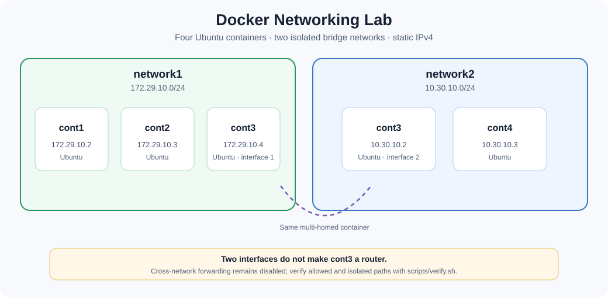
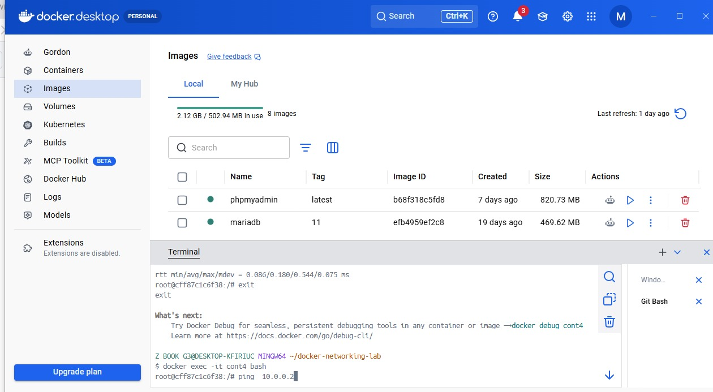
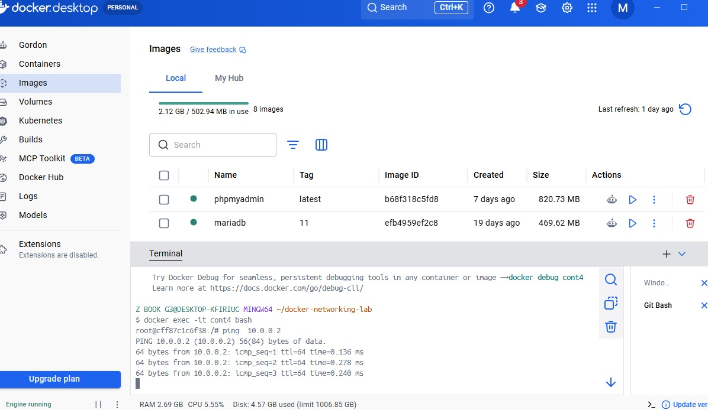
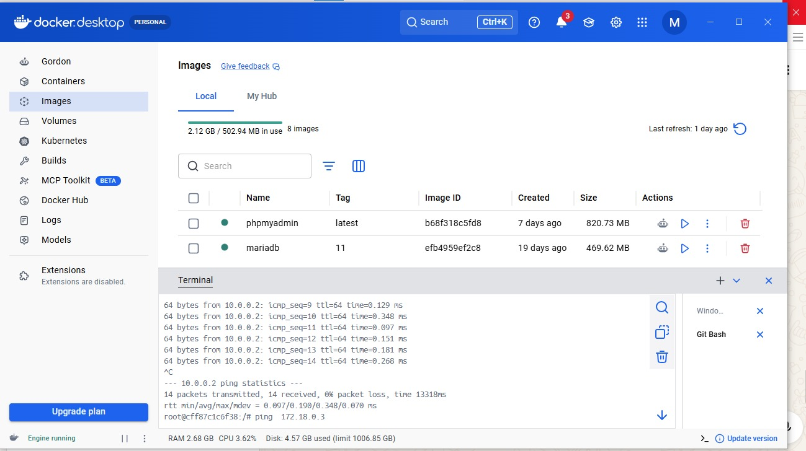
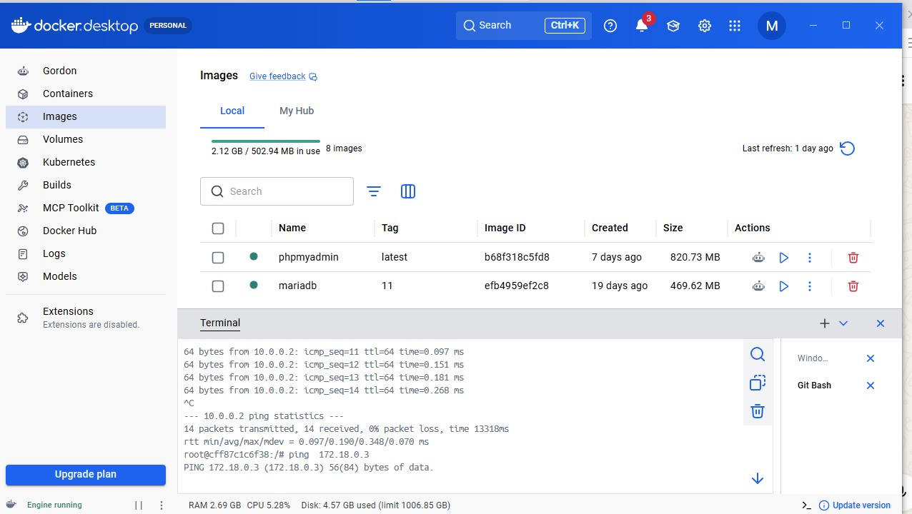

# 🐳 Docker Networking Lab

<div align="center">



<h3>Hands-on Docker Networking & Container Communication</h3>

<p>
<strong>Custom Bridge Networks</strong> •
<strong>Static IP Addressing</strong> •
<strong>Network Isolation</strong> •
<strong>Multi-Network Containers</strong>
</p>

</div>
---

## 📌 Project Overview

This project is a hands-on Docker networking laboratory designed to demonstrate how Docker containers communicate through custom bridge networks.

The lab focuses on practical container networking concepts including:

- Custom Docker bridge networks
- Static IPv4 addressing
- Container-to-container communication
- Network isolation
- Multi-homed containers
- Docker network inspection
- Connectivity testing
- Basic container networking troubleshooting

The environment consists of **four Ubuntu containers** distributed across **two isolated Docker bridge networks**.

## 🚀 Quick Start (Docker Compose)

Requirements: Docker Engine with the Compose plugin and Bash. The Compose setup builds an Ubuntu lab image with `ping` and `ip` tools, creates the four containers and two project-scoped bridge networks, and assigns the addresses shown below.

```bash
./scripts/setup.sh
./scripts/verify.sh
```

The verification script checks three permitted paths and one cross-network path that should remain isolated. To inspect addresses:

```bash
docker compose exec cont3 ip -br address
docker compose ps
```

Stop and remove only this Compose project’s containers and networks with:

```bash
docker compose down
```

If Docker reports that a subnet overlaps an existing host or Docker route, update both the subnet and assigned addresses in `docker-compose.yml` and the corresponding README examples. Do not run the manual CLI setup and Compose setup at the same time; both use the same subnets.

---

## 🏗️ Network Architecture

The lab uses two custom Docker bridge networks:

```text
                         Docker Host
                              │
                 ┌────────────┴────────────┐
                 │                         │
          ┌──────▼──────┐           ┌──────▼──────┐
          │  network1   │           │  network2   │
          │172.29.10.0/24│           │ 10.30.10.0/24 │
          └──────┬──────┘           └──────┬──────┘
                 │                         │
          ┌──────┼──────┐                  │
          │      │      │                  │
        cont1  cont2   cont3              cont4
        .2     .3      .4                 .3
                         │
                         │
                  Second Interface
                         │
                    10.30.10.2
                         │
                         ▼
                      network2
```

### Network 1

```text
Network: 172.29.10.0/24

cont1 → 172.29.10.2
cont2 → 172.29.10.3
cont3 → 172.29.10.4
```

### Network 2

```text
Network: 10.30.10.0/24

cont3 → 10.30.10.2
cont4 → 10.30.10.3
```

`cont3` is a **multi-homed container** because it is connected to both Docker networks.

> **Important networking concept:** Connecting a container to multiple Docker networks does not automatically turn that container into a router. Traffic between the two networks remains isolated unless IP forwarding and appropriate routing are explicitly configured.

---

## 🌐 Network Configuration

| Container | Network | IP Address | Role |
|-----------|---------|------------|------|
| `cont1` | `network1` | `172.29.10.2` | Network 1 container |
| `cont2` | `network1` | `172.29.10.3` | Network 1 container |
| `cont3` | `network1` | `172.29.10.4` | Multi-network container |
| `cont3` | `network2` | `10.30.10.2` | Multi-network container |
| `cont4` | `network2` | `10.30.10.3` | Network 2 container |

---

## 🚀 Manual Implementation

### 1. Create Docker Networks

```bash
docker network create \
  --driver bridge \
  --subnet 172.29.10.0/24 \
  network1
```

```bash
docker network create \
  --driver bridge \
  --subnet 10.30.10.0/24 \
  network2
```

### 2. Create Containers

#### Container 1

```bash
docker run -dit \
  --name cont1 \
  --network network1 \
  --ip 172.29.10.2 \
  ubuntu bash
```

#### Container 2

```bash
docker run -dit \
  --name cont2 \
  --network network1 \
  --ip 172.29.10.3 \
  ubuntu bash
```

#### Container 3

```bash
docker run -dit \
  --name cont3 \
  --network network1 \
  --ip 172.29.10.4 \
  ubuntu bash
```

#### Container 4

```bash
docker run -dit \
  --name cont4 \
  --network network2 \
  --ip 10.30.10.3 \
  ubuntu bash
```

### 3. Connect `cont3` to Network2

```bash
docker network connect \
  --ip 10.30.10.2 \
  network2 \
  cont3
```

At this point, `cont3` has two network interfaces:

```text
network1 → 172.29.10.4
network2 → 10.30.10.2
```

---

## ⚙️ Automated Setup

The Bash setup script builds and starts the declared Compose topology. Unlike the previous sequence of `docker network create` and `docker run` commands, Compose reports actual setup errors and scopes created resources to this project.

```bash
./scripts/setup.sh
```

The Compose project creates:

- `network1`
- `network2`
- `cont1`
- `cont2`
- `cont3`
- `cont4`

It connects `cont3` to both Docker networks. `scripts/verify.sh` then tests the expected connectivity and isolation.

---

## 🔍 Verify the Configuration

```bash
docker ps
docker network inspect network1
docker network inspect network2
docker inspect cont3
docker exec -it cont3 ip addr
```

---

## 🧪 Connectivity Testing

Install the `ping` utility inside the Ubuntu containers when required:

```bash
apt update
apt install -y iputils-ping
```

### Same-Network Communication

```bash
# cont1 → cont2
ping 172.29.10.3

# cont1 → cont3
ping 172.29.10.4

# cont4 → cont3
ping 10.30.10.2
```

Containers connected to the same Docker bridge network can communicate directly.

---

## 🔒 Network Isolation

Containers connected only to different Docker bridge networks cannot communicate directly by default.

For example:

```bash
# cont4 → cont2
ping 172.29.10.3
```

This communication is not expected to succeed because `cont4` belongs to `network2`, while `cont2` belongs only to `network1`.

```text
cont4
  │
  ▼
network2
  │
  X
network1
  │
  ▼
cont2
```

This demonstrates Docker's default network isolation between separate bridge networks.

---

## 📸 Test Results

The screenshots below document an earlier manual run and show the previous IP ranges. The current Compose topology and verification script are authoritative for the default addresses.

### Container Connectivity Testing



### Docker Network Communication



### Multi-Network Connectivity



### Successful Connectivity Verification



---

## 🧠 Key Concepts Demonstrated

- Docker bridge networking
- Custom network creation
- Static IPv4 addressing
- Container network membership
- Multi-homed containers
- Container-to-container communication
- Network isolation
- Docker network inspection
- Network interface inspection
- ICMP connectivity testing
- Basic networking troubleshooting
- Bash-based environment automation

---

## 🛠️ Technologies Used

| Technology | Purpose |
|------------|---------|
| 🐳 Docker | Containerization and networking |
| 🐧 Ubuntu Linux | Container operating system |
| 🔗 Docker Bridge Networks | Container connectivity and isolation |
| 💻 Docker CLI | Container and network management |
| 📜 Bash | Environment automation |
| 🔧 Git | Version control |
| 🌐 GitHub | Source code hosting |

---

## 🎯 Learning Outcomes

This project provides practical experience with Docker networking fundamentals.

It demonstrates how to:

- Create custom Docker bridge networks
- Assign static IPv4 addresses
- Connect containers to specific networks
- Connect one container to multiple networks
- Test container connectivity
- Understand Docker network isolation
- Inspect Docker network configuration
- Inspect container network interfaces
- Troubleshoot basic networking issues
- Automate environment setup with Bash

---

## 💡 Important Networking Insight

A container connected to multiple networks does **not** automatically become a router.

```text
             network1
          172.29.10.0/24
                │
              cont3
                │
        ┌───────┴───────┐
        │               │
  172.29.10.4        10.30.10.2
        │               │
        └───────┬───────┘
                │
             network2
           10.30.10.0/24
```

`cont3` has interfaces on both networks, but forwarding traffic between them requires explicit IP forwarding and routing configuration.

---

## 📂 Project Structure

```text
Docker-networking-lab/
│
├── README.md
├── Dockerfile
├── docker-compose.yml
├── architecture.svg
├── .github/workflows/validate.yml
├── scripts/
│   ├── setup.sh
│   └── verify.sh
│
└── screenshots/
    ├── first-image.jpeg
    ├── second-image.jpeg
    ├── third-image.jpeg
    └── fourth-image.jpeg
```

---

## 👤 Author

### Mohamed Ahmed Abdo

**Junior DevOps & Cloud Engineer**

Focused on:

```text
Linux
Docker
Docker Compose
AWS
Git
Bash
Python
Automation
Containerization
Networking
Cloud Infrastructure
```

---

## 🔗 Connect With Me

<div align="center">

<a href="https://github.com/mhmdhmdbdh2050">

</a>

<a href="https://www.linkedin.com/in/mohamed-ahmed-6705b3303/">

</a>

<a href="mailto:ahmedmohamed05147@gmail.com">

</a>

</div>

---

<div align="center">

### 🐳 Build • Connect • Automate • Troubleshoot

**Docker Networking Lab**

</div>
